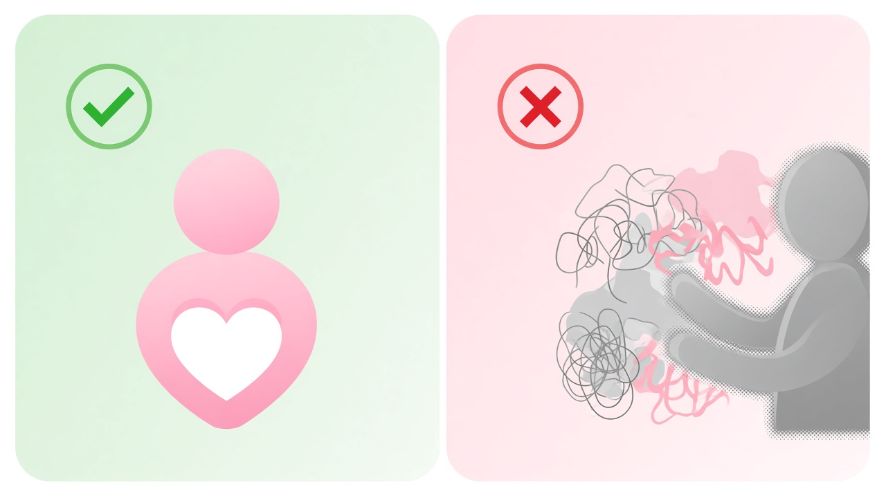

# Bicep Heart Video Guide (Unofficial)

> **Disclosure:** This guide is written by the makers of [BicepHeart.tools](https://bicepheart.tools/?utm_source=github&utm_medium=repo&utm_campaign=bicep-heart), an unofficial AI tool for the trend. It is not affiliated with, endorsed by, or connected to TikTok, X, or the trend's original creators.

## What is the bicep heart trend?

The **bicep heart** is a one-person pose. You flex one arm with the fist raised near your head, then press your other hand against the inside of that bicep, thumb pointing down and fingers curled, so the arm and the hand together form a heart ([BoxLife](https://boxlifemagazine.com/bicep-heart-trend-tiktok-viral/), [Mathrubhumi](https://english.mathrubhumi.com/lifestyle/bicep-heart-trend-how-to-try-viral-challenge-j0qbfi6w), [MimicZip](https://mimiczip.com/bicep-heart)). The #bicepheart hashtag appeared on TikTok on October 26, 2026 and took off in the last days of October, usually set to the same original sound and opened with "Have you ever heard of a bicep heart…" ([BoxLife](https://boxlifemagazine.com/bicep-heart-trend-tiktok-viral/), [ViralRemix](https://viralremix.org/bicep-heart-trend)). The original is a solo selfie clip. Couple and pet versions are later creative spin-offs.

## Contents

| Doc | What it covers |
|---|---|
| [docs/pose-guide.md](docs/pose-guide.md) | Bicep heart pose steps for solo, couple, and pet versions |
| [docs/photo-checklist.md](docs/photo-checklist.md) | Choosing a photo if you make the video with AI |
| [docs/model-notes.md](docs/model-notes.md) | Seedance 2.5 vs Kling 4.0: official facts, third-party reports, and our inferences, kept separate |
| [docs/faq.md](docs/faq.md) | Common questions, including bicep heart vs finger heart |

## How to do the bicep heart pose yourself

These steps follow the published descriptions ([BoxLife](https://boxlifemagazine.com/bicep-heart-trend-tiktok-viral/), [Mathrubhumi](https://english.mathrubhumi.com/lifestyle/bicep-heart-trend-how-to-try-viral-challenge-j0qbfi6w), [ViralRemix](https://viralremix.org/bicep-heart-trend)):

1. **Flex one arm** with your fist raised near your head.
2. **Bring the other hand across your chest** and place it against the inside of the flexed bicep.
3. **Point your thumb down and curl your fingers** over the arm, so your hand forms half of the heart.
4. **Angle the arm toward the camera** until the curve of your arm and hand reads as a heart.

You don't need big arms. The hand placement does most of the shape-forming work ([BoxLife](https://boxlifemagazine.com/bicep-heart-trend-tiktok-viral/)). For details, the couple and pet spin-offs, and common mistakes, see [docs/pose-guide.md](docs/pose-guide.md).

## Making a bicep heart video with AI from one photo

If you'd rather not film yourself, or want a pet version, an image-to-video model can animate a single photo into the pose. Results vary a lot by photo, so start with [docs/photo-checklist.md](docs/photo-checklist.md): clear arms, upper body in frame, even light, no heavy filters.

Options include:

- **Official model apps and APIs**, e.g. ByteDance's Seedance 2.5 (via Dreamina / BytePlus) and Kuaishou's Kling 4.0 (kling.ai). These give you the most control and you pay the providers directly.
- **Third-party platforms** that resell those models (fal, OpenRouter, Runway's developer API, and others). We can't independently verify which model version a reseller runs; see [model notes](docs/model-notes.md).
- **Template tools** built for this one trend, such as our own **[BicepHeart.tools bicep heart AI video generator](https://bicepheart.tools/?utm_source=github&utm_medium=repo&utm_campaign=bicep-heart#how-it-works)**: upload one photo, choose 1-person, 2-person, or pet mode, and get a short vertical video. Paid per video pack (from $3.99 at the time of writing, no subscription). Output quality depends on the input photo and isn't guaranteed.

There is no single "best" model for this trend. Public tests show each has strengths (Kling won a hand-detail test; Seedance won tests on photo fidelity and realism), and nobody has published a pet-specific comparison. See [docs/model-notes.md](docs/model-notes.md).

## Keywords people use

bicep heart, bicep heart pose, bicep heart tiktok, bicep heart trend, bicep heart ai video generator, bicep heart couple, bicep heart pet, arm heart pose.

## Responsible use

- Only animate photos of people who agreed to it. Don't use photos of celebrities or strangers.
- Label AI-generated clips as AI-generated when you post them.
- Nothing in this repo implies that any creator or public figure uses or endorses any tool.

## Contributing

See [CONTRIBUTING.md](CONTRIBUTING.md).

## License

Documentation is licensed under [CC BY 4.0](LICENSE).

## Sources

Accessed 2026-11-05 unless noted. Model-related sources are listed in full in [docs/model-notes.md](docs/model-notes.md#sources).

- BoxLife Magazine, trend explainer: https://boxlifemagazine.com/bicep-heart-trend-tiktok-viral/
- Mathrubhumi English, how-to: https://english.mathrubhumi.com/lifestyle/bicep-heart-trend-how-to-try-viral-challenge-j0qbfi6w
- ViralRemix, trend page and timeline: https://viralremix.org/bicep-heart-trend
- MimicZip, trend description: https://mimiczip.com/bicep-heart

- Seedance 2.5 overview: https://seed.bytedance.com/en/seedance2_5
- Seedance 2.5 launch blog (2026-07-31): https://seed.bytedance.com/en/blog/one-take-creation-flexible-referencing-introducing-seedance-2-5
- Kling 4.0 launch (Kuaishou IR): https://ir.kuaishou.com/news-releases/news-release-details/kling-ai-officially-launches-next-generation-kling-40-raising/
- Kling API pricing: https://kling.ai/document-api/pricing/base/video.md
